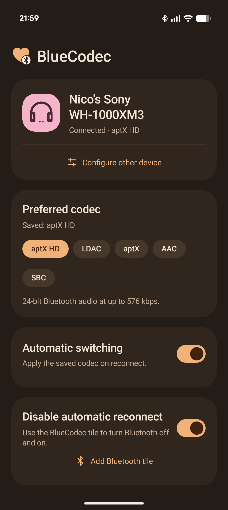
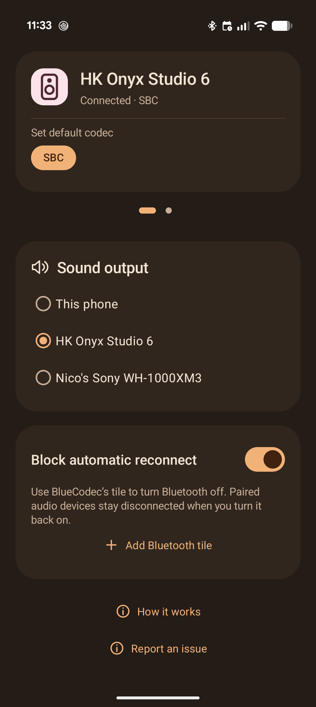

<p align="center"></p>
<h1 align="center">BlueCodec</h1>
<p align="center">Take control of Bluetooth reconnects, volume, sound output, and audio codecs on Android.</p>
<p align="center"><a href="https://github.com/nixolas1/bluecodec/releases/latest">Download APK</a> · <a href="https://github.com/nixolas1/bluecodec/issues">Report a problem</a> · <a href="LICENSE">MIT license</a></p>

BlueCodec is a **Bluetooth audio utility for Android**, built to address missing
controls and audio problems encountered on a **Pixel 10 Pro running Android 17**.
Stop unwanted Bluetooth auto reconnect, recover volume control after reconnecting,
switch between Bluetooth speakers and the phone speaker, and remember a preferred
Bluetooth codec for each device. Uses [Shizuku](https://shizuku.rikka.app/); **no root required**.

## Bluetooth problems BlueCodec addresses

### Stop Bluetooth from automatically reconnecting

Turning Bluetooth back on can reconnect nearby headphones, speakers, or car audio
before you choose a device. On the tested Pixel, Android provides no built-in
setting to keep paired audio devices available while preventing this automatic
reconnection after a Bluetooth off/on cycle.

Enable **Block automatic reconnect** and use BlueCodec's **Bluetooth Quick
Settings tile** to turn Bluetooth off. The next time you enable Bluetooth, BlueCodec blocks classic-audio reconnects
for the first 2 seconds. After that, a headset you turn on can connect normally. Pairings stay intact. This adds control over Android's
default reconnect behavior; it is separate from the update-related issues below.

### Fix low Bluetooth volume after reconnecting

If your **Bluetooth speaker is too quiet after reconnecting**, or the phone's
volume slider stops controlling the speaker correctly, Android may have lost
Bluetooth absolute-volume synchronization. This was observed with Onyx Studio 6
and a Samsung soundbar on the tested Pixel 10 Pro after a recent Android update.

BlueCodec detects the specific missing volume registration we diagnosed and
restores it automatically when its service is running. It checks the device and
route first and keeps the initial volume conservative. It is a **Bluetooth volume
sync workaround**, not a volume booster or a way to bypass hearing protection.

### Switch audio output when Android's media picker gets stuck

The **Android sound output picker** can show “This phone” while audio is actually
playing on a Bluetooth speaker. Tapping a device may leave a loading indicator
without switching output. We encountered this on the Pixel 10 Pro after the update,
including after a reboot.

BlueCodec's **Sound output** radio buttons let you switch from Bluetooth to the
phone speaker, or between connected Bluetooth audio devices. It uses Android's
media-routing controls through Shizuku and confirms the actual route before
marking an output selected. On our test phone, the system picker also recovered
after these switches, but that recovery is not guaranteed.

### Remember a default Bluetooth codec for each device

Android exposes [Bluetooth codec controls in Developer options](https://developer.android.com/studio/debug/dev-options#networking),
but the tested Pixel has no normal setting for a persistent, per-device default
codec that is automatically reapplied after reconnecting.

BlueCodec saves your choice of **LDAC, aptX HD, aptX, AAC, or SBC**, when supported
by the phone and connected device. Enable **Apply on reconnect** to reapply that
preference automatically. Swipe between connected devices to configure each one;
changing the configuration card does not switch playback.

## Screenshots

<p align="center">
  
  
</p>

Real device captures of the current interface. Codec choices depend on the
connected device; speakers with only SBC do not show an Apply on reconnect toggle.

## Pixel 10 Pro / Android update compatibility

**Early release.** The volume and output-picker problems were observed on our
Pixel 10 Pro after a recent update. The output-picker investigation used Android
17 build `CP3A.261005.005` in October 2026. We have not established that the update
caused either fault or that all Pixel 10 Pro phones are affected.

Testing includes Sony WH-1000XM3 headphones, HK Onyx Studio 6, and a Samsung
soundbar. Android 12+ can install BlueCodec, but these Bluetooth workarounds depend
on firmware. Reconnect blocking covers classic A2DP/HFP audio; the output picker
covers classic A2DP. LE Audio, hearing aids, and casting are not supported by the
output control. See [verification and test limits](docs/verification.md).

## Install and set up

1. Install and start [Shizuku](https://shizuku.rikka.app/guide/setup/).
2. Download the APK from [Releases](https://github.com/nixolas1/bluecodec/releases/latest)
   and install it. Android may ask you to allow installation from your browser or file manager.
3. Open BlueCodec. Grant **Nearby devices**, allow Shizuku access, and allow the
   monitoring notification when prompted.
4. Connect a headset. Select its codec and enable **Apply on reconnect** if it has
   more than one codec. Swipe its card to configure another connected device.

Only codecs supported by the current phone/headset connection appear. Saving LDAC,
for example, cannot add LDAC support to headphones that don't have it. Android still
negotiates sample rate and bit depth and may fall back to another codec.

### Install and update with Obtainium

[Obtainium](https://obtainium.imranr.dev/) can install BlueCodec and check for
updates directly from this repository's GitHub Releases.

[Add BlueCodec to Obtainium](https://apps.obtainium.imranr.dev/redirect?r=obtainium://app/%7B%22id%22%3A%22no.nixo.bluecodec%22%2C%22url%22%3A%22https%3A%2F%2Fgithub.com%2Fnixolas1%2Fbluecodec%22%2C%22author%22%3A%22nixolas1%22%2C%22name%22%3A%22BlueCodec%22%7D)

Or add it manually:

1. Open Obtainium's **Add App** screen.
2. Enter `https://github.com/nixolas1/bluecodec` as the source URL. Obtainium
   should select **GitHub** as the source.
3. Add the app and install the release APK. Allow Obtainium to install apps if
   Android asks. If you already have the official release installed, Obtainium
   can track updates for that installation.

Official releases use package ID `no.nixo.bluecodec` and include an APK asset.
No custom source or APK filter is needed for the current single-APK releases.
Obtainium handles update checks; **Shizuku is still required** for BlueCodec's
Bluetooth controls and must be started again after a phone restart.

A locally built debug APK uses a different signing key and cannot be updated
with the official release. Before uninstalling that build, turn Bluetooth and
Shizuku on, turn **Block automatic reconnect** off, and let restoration finish.
Keep the existing installation when updating between official releases.

See [Obtainium's guide](https://wiki.obtainium.imranr.dev/ui_overview/) for
source configuration and update settings.

## Stop automatic reconnect

**Experimental · Tested on Pixel 10 Pro / Android 17.** This feature depends on
firmware-specific Bluetooth behavior. For other devices, see the
[device adaptation guide](docs/device-compatibility.md) to investigate compatibility,
implement a device-specific adapter, and build your own APK.

1. Enable **Block automatic reconnect** in BlueCodec.
2. Tap **Add Bluetooth tile** and accept Android's prompt. On Android 12, add it
   manually through the Quick Settings editor.
3. Use the **Bluetooth tile from BlueCodec** to switch Bluetooth off and on.
4. When you want to connect, long press the tile and select your headset in Android
   Settings. You can also use **Connect** in BlueCodec.

After Bluetooth starts, a 2-second blocking window suppresses startup reconnects.
BlueCodec then permits headset-initiated connections while keeping Android’s
outgoing automatic reconnect policy disabled. A newly connected headset becomes
the media output, including when you previously selected the phone speaker.
The timing and headset behavior still need physical-device verification.

The toggle does not disconnect your current headset. It changes what happens the
next time you switch Bluetooth off with BlueCodec's tile. Android's built-in
Bluetooth-off switch does not run the blocking step.

With **Block automatic reconnect** off, the tile is a normal Bluetooth power
switch. Turning the setting off restores the connection settings BlueCodec saved;
nearby headsets may then reconnect. If Bluetooth is off, restoration waits until
it is on again.

**Before uninstalling or clearing BlueCodec's data:** turn Bluetooth and Shizuku
on, turn **Block automatic reconnect** off, and let restoration finish. Otherwise,
saved headset profiles can remain blocked after the app is removed.

## Quick Settings sizes

Turning Bluetooth on with BlueCodec's tile also opens Android's Bluetooth settings
so you can choose a device to connect. Turning it off keeps you in Quick Settings.

Android controls the tile's size and appearance. On the tested Pixel:

| Size / connection | Display |
| --- | --- |
| Compact 1×1 | Bluetooth icon |
| Wide 2×1, one device | Saved device name, then battery percentage when available |
| Wide 2×1, multiple devices | Bluetooth, then “2 devices” (or the actual count) |
| No connected devices | Bluetooth, then On or Off |

Unknown battery levels show **Connected** instead of an invented percentage.
Android does not expose its built-in Bluetooth tile's split background or separate
icon/text click targets to app tiles.

## Compatibility and recovery

- **Shizuku must be running.** After a phone restart, start Shizuku again and open
  BlueCodec. Force-stopping the app also requires reopening it to resume monitoring.
- **Reconnect blocking covers classic audio:** A2DP and HFP. It does not cover
  LE Audio, watches, keyboards, or every Bluetooth profile.
- **Android Settings connections use a compatibility bridge.** BlueCodec reads
  the Bluetooth service's live, explicit connection requests through Shizuku. It
  verifies the Settings/SystemUI caller and opens only the selected device. This
  depends on firmware log behavior and is currently verified on the Pixel above.
- **If Settings cannot connect:** keep Shizuku running and try **Connect** in
  BlueCodec. To return to normal Android behavior, turn **Block automatic
  reconnect** off with Bluetooth on.
- **Codec changes are bounded.** BlueCodec verifies the negotiated result and
  stops retrying if the phone/headset rejects the preference.

See [verification and test limits](docs/verification.md) for what was actually tested.

## Privacy and permissions

BlueCodec has **no Internet permission, analytics, ads, or account**. Device
identifiers and preferences stay in app-private storage. It does not remove
pairings or change firmware.

| Access | Purpose |
| --- | --- |
| Nearby devices | Read Bluetooth state and receive connection events |
| Shizuku | Apply codecs, manage reconnect policies, switch media output, recover volume synchronization, and toggle Bluetooth power |
| Foreground service / notifications | Keep automatic codec switching and manual connection handling running |
| Boot completed | Offer a reminder to resume after restart |

The connection-request bridge reads only a filtered Bluetooth log stream, keeps a
small in-memory queue, and does not save log contents. The monitoring notification
does not create a launcher notification dot.

## Build

Requires **JDK 17** and **Android SDK 36**. Set `ANDROID_HOME` or add `sdk.dir` to an
untracked `local.properties` file.

```sh
./gradlew assembleDebug lintDebug assembleDebugAndroidTest
```

Debug APK: `app/build/outputs/apk/debug/app-debug.apk`.

Instrumentation tests use fake Bluetooth services and isolated preferences:

```sh
adb -s <test-device> install -r app/build/outputs/apk/debug/app-debug.apk
adb -s <test-device> install -r app/build/outputs/apk/androidTest/debug/app-debug-androidTest.apk
adb -s <test-device> shell am instrument -w \
  no.nixo.bluecodec.test/androidx.test.runner.AndroidJUnitRunner
```

To build a signed release, set `BLUECODEC_SIGNING_PROPERTIES` to a private properties
file containing `storeFile`, `storePassword`, `keyAlias`, and `keyPassword`, then run:

```sh
./gradlew assembleRelease lintRelease
```

Keep signing keys and passwords outside the repository. Without signing properties,
Gradle creates an unsigned release APK. Official releases use a dedicated signing
key; they cannot update a locally debug-signed build. Restore connection settings
before uninstalling a development build to switch to the release APK.

## Contributing

Bug reports are especially useful from other phones. Include phone model, Android
version, Shizuku version, headset model, and steps to reproduce. Please redact MAC
addresses and unrelated personal information from diagnostics.

Code changes and compatibility fixes are welcome. Start with the
[device adaptation guide](docs/device-compatibility.md) for reconnect support. The main components are
`CodecService` (Shizuku access), `CodecController` (serialized operations and retries),
`ReconnectSettings` (connection policies and restoration), and
`ManualConnectionRequests` (Android Settings compatibility).

## License

[MIT](LICENSE). Built with [Shizuku API](https://github.com/RikkaApps/Shizuku-API)
and [Material Components for Android](https://github.com/material-components/material-components-android).
